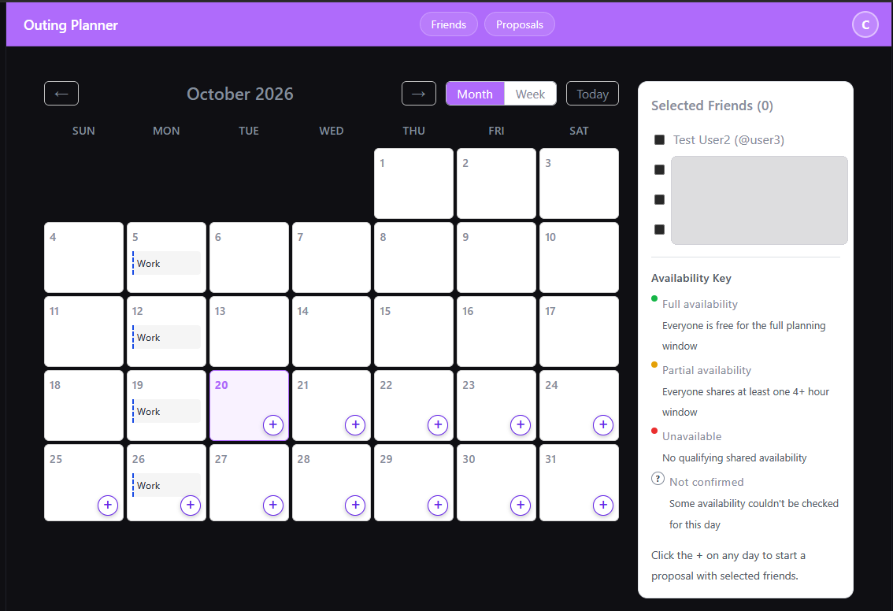
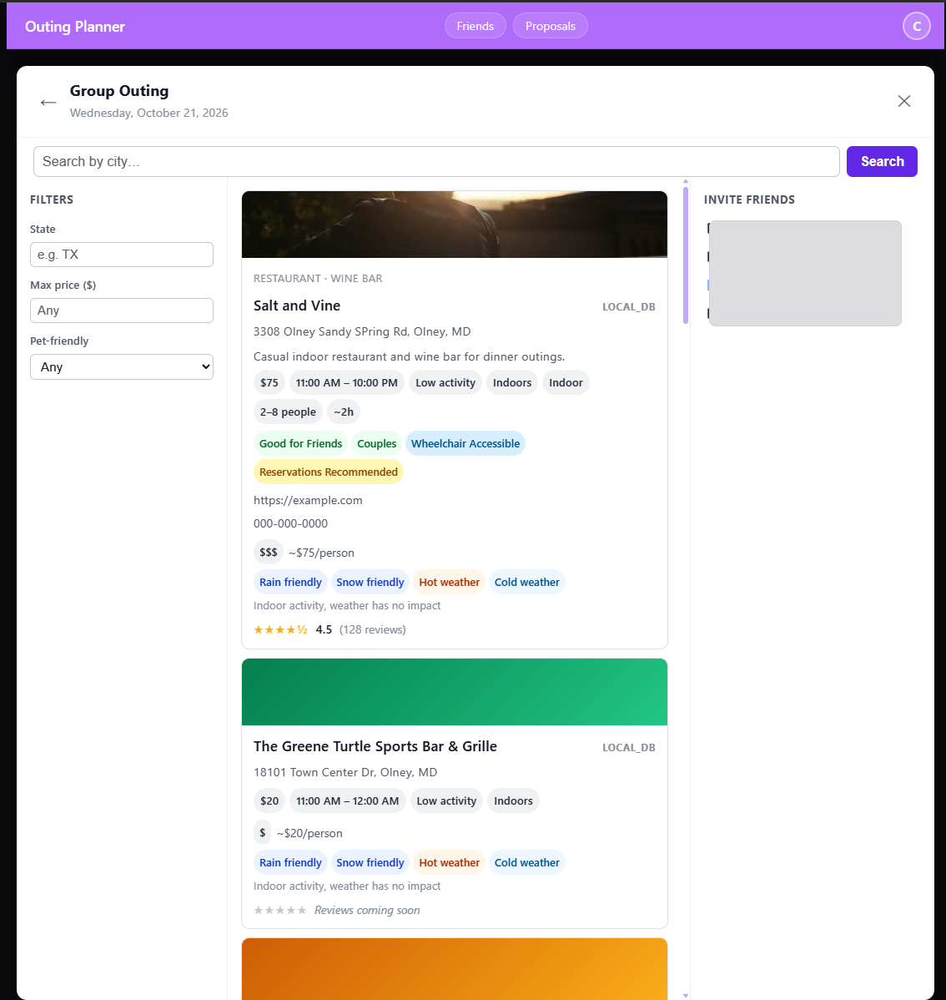
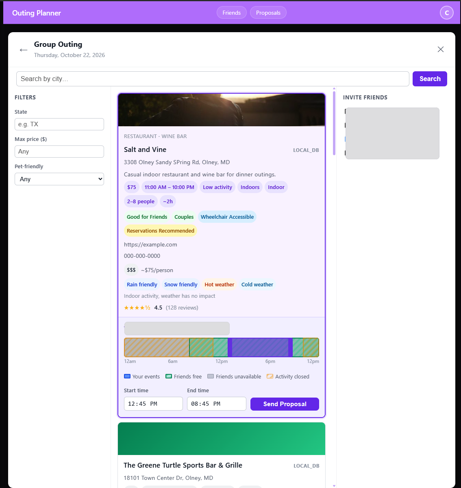
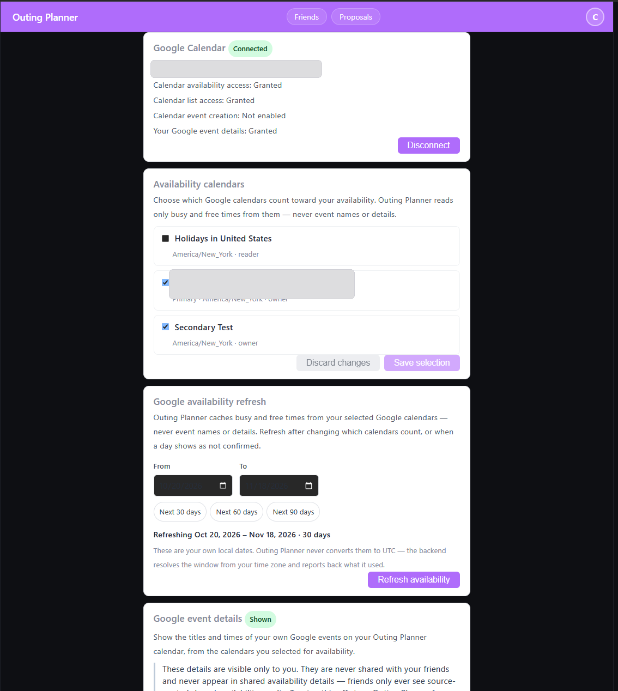
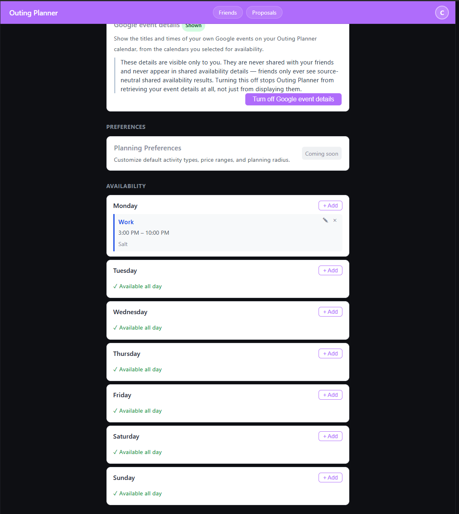
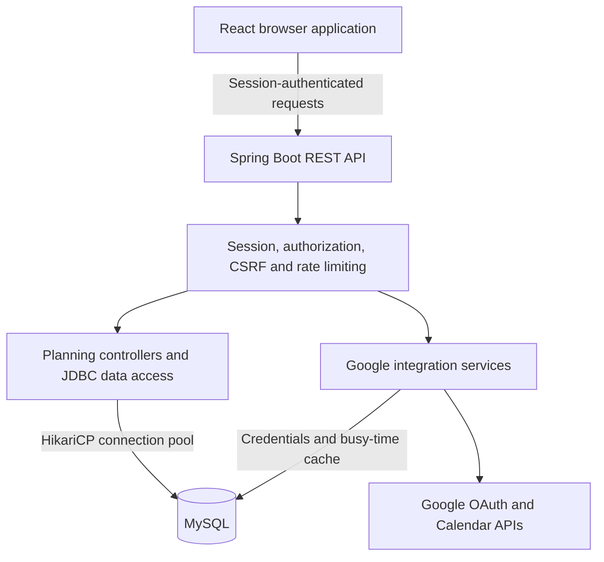

# Outing Planner

**Less back-and-forth. More getting together.**

A full-stack scheduling application that helps friends find shared free time and turn an outing proposal into a confirmed group plan.

**React 19 · Java 17 · Spring Boot 4 · MySQL · Google Calendar API**

**Active development · Pre-MVP · Portfolio showcase**

[Features](#implemented-features) · [Preview](#application-preview) · [Architecture](#system-architecture) · [Engineering](#engineering-highlights) · [Testing](#testing-infrastructure) · [Roadmap](#roadmap)

## Overview

Planning an outing usually means comparing schedules across several conversations, choosing an activity, and checking whether everyone can make it. Outing Planner brings schedule coordination, activity browsing, invitations, and confirmation into one application.

A typical flow is to **compare availability → choose an activity → propose a time → collect responses → confirm the group outing**. Connected Google calendars can contribute busy time without exposing a friend's event details.

This repository presents the product and its engineering. Application source and development infrastructure remain private. It does not provide an installable application or a public live demo.

## Implemented features

These capabilities were checked against the development repository's main-branch implementation and documentation on **October 20, 2026**.

| Area | Current behavior |
| --- | --- |
| Accounts | Registration, login, logout, profile updates, and session restoration after a browser refresh |
| Calendar | Personal events and scheduled outings in a shared calendar interface, with month navigation and availability overlays |
| Scheduling constraints | Recurring weekly unavailability, event conflict checks, past-date guards, and activity operating-hours validation |
| Friends | Search by username or email; send, accept, decline, and remove friend connections |
| Shared availability | Compare one or multiple friends' free windows over selected dates |
| Group planning | Create proposals, accept or decline invitations, cancel proposals, and confirm accepted proposals into group outings |
| Activity browsing | Browse the existing database catalog and filter by city, price, pet-friendliness, and physical activity |
| Google Calendar | OAuth connection and disconnect, calendar selection, explicit free/busy refresh, and optional display of the connected owner's timed and all-day events |

**Calendar privacy:** Friends' Google busy time affects shared availability calculations. Their Google event titles, descriptions, and individual busy-event cards are not returned as part of shared availability. Owner event display is separately permissioned and optional.

**Booking boundary:** Confirming an outing schedules it within Outing Planner. It does not make a restaurant reservation, purchase tickets, or create an event in Google Calendar.

## Application preview

### Calendar and shared availability

The main calendar brings personal events, friend selection, and shared availability into one planning view.

### Explore the application

| Activity discovery | Group planning |
| :---: | :---: |
|  |  |
| Browse the development catalog by city and filters, then inspect venue details. Example listings contain demonstration content. | Select an activity, compare the displayed time windows, choose a time, and send an outing proposal. |

| Google Calendar connection | Availability preferences |
| :---: | :---: |
|  |  |
| Manage the read-only connection, select availability calendars, refresh busy time, and control owner-event display. | Set recurring weekly unavailability. The separate Planning Preferences panel is marked coming soon. |

Screenshots show the development application. The supplied images were reviewed and approved by the project owner for public display. See [screenshot review](SCREENSHOT_REVIEW.md).

## Technology stack

| Layer | Technologies |
| --- | --- |
| Frontend | React 19, JavaScript, Vite 8, CSS, pnpm |
| Backend | Java 17, Spring Boot 4, Maven, REST controllers |
| Persistence | MySQL 8, handwritten JDBC with prepared statements, HikariCP connection pooling, SQL migrations |
| Authentication | Spring Session JDBC, BCrypt password hashing, session ownership checks, CSRF protection |
| External integration | Google OAuth 2.0, Calendar List, FreeBusy, and read-only owner-event access |
| Verification | JUnit 5, Spring MockMvc, Vitest, React Testing Library, jsdom, ESLint, GitHub Actions |

## System architecture

Core planning rules live in controllers and JDBC data-access classes; Google-specific services handle OAuth and provider operations. MySQL stores application data, server-side sessions, encrypted Google credentials, and cached busy intervals.

Free/busy refresh is explicit and bounded. Availability calculations use the cache rather than calling Google for every comparison. Optional owner-event display reads from Google and does not persist event content. Frontend updates currently use polling.

## Engineering highlights

- **Availability as interval processing.** Combine personal events, scheduled outings, recurring constraints, and cached external busy time; subtract busy intervals and intersect participants' free windows to identify shared time.
- **Privacy enforced across data paths.** Separate owner-only Google event display from shared availability. Disabling owner display stops retrieval in the backend, rather than merely hiding cards in the browser.
- **Time-zone and boundary handling.** Persist external busy intervals in UTC, project them into user-local dates, and handle midnight crossings and all-day versus timed events. Regression checks include raw stored UTC values across multiple JVM time zones.
- **A controlled proposal lifecycle.** Only the creator can confirm a proposal, confirmation requires accepted invitations, and expired proposals cannot be confirmed. Leaving a confirmed group outing affects the individual participant.
- **Security beyond the login screen.** Server-side sessions, session rotation on authentication, route ownership checks, CSRF validation, prepared statements, per-IP rate limiting, and encrypted provider tokens.
- **Integration discipline.** Frontend/backend contracts, explicit schema changes, focused regression tests, pull-request review, and separate CI checks support changes across the stack.

## Testing infrastructure

The private development repository has four distinct GitHub Actions gates:

| Gate | What it checks |
| --- | --- |
| Backend Tests | Maven/JUnit suite, including HTTP-level MockMvc tests against disposable MySQL |
| Frontend Tests | Vitest unit and component tests with jsdom and React Testing Library |
| Frontend Build | Vite production build |
| Frontend Lint | ESLint checks |

Backend CI initializes a base schema and replays SQL migrations in an isolated MySQL container. Frontend jobs install dependencies from the frozen lockfile. Failing backend runs retain test reports for diagnosis.

**Recorded CI baseline — September 2026:** 628 backend tests executed, with zero failures/errors and one intentional skip; 686 frontend tests passed. All four gates were demonstrated passing. A separate, unmerged negative-control branch deliberately changed two assertions: both test gates failed while build and lint remained green.

These are historical verification results, not a new test run or a claim about current-head CI. Test count is not a coverage percentage. Application CI runs in the private development repository; this showcase has no application build.

## Development status

**Pre-MVP, with working account, calendar, friendship, proposal, and inbound Google Calendar flows.** The implementation is under active development and is not presented as production-ready.

Current limitations include a seeded activity catalog, polling instead of push updates, an explicitly refreshed external-availability cache, and in-memory rate limiting suited to a single application instance. External calendar refresh recovery, calendar selection controls, and remaining scheduling/filter edge cases need further work.

## Roadmap

| Priority area | Planned work |
| --- | --- |
| Reliability | Improve Google free/busy error recovery and resolve remaining scheduling and filtering edge cases |
| Discovery | Expand the places and activities catalog and improve discovery |
| Real-world planning | Define reservation and booking handoffs or integrations |
| Calendar export | Write confirmed Outing Planner events to Google Calendar |
| Provider support | Explore Apple Calendar integration |
| Product polish | Improve update delivery, usability, and the demo experience |

Roadmap items are proposed work, not implemented capabilities or delivery commitments.

## Project ownership

An independently initiated full-stack project covering product planning, architecture coordination, frontend/backend integration, testing, and iterative development. AI-assisted coding and review tools are part of the development workflow.

The emphasis is on making engineering decisions explicit, validating behavior across the stack, and turning a practical coordination problem into a maintainable application.

---

Showcase verified October 20, 2026. Public materials are intentionally limited to this overview and reviewed visual assets.

