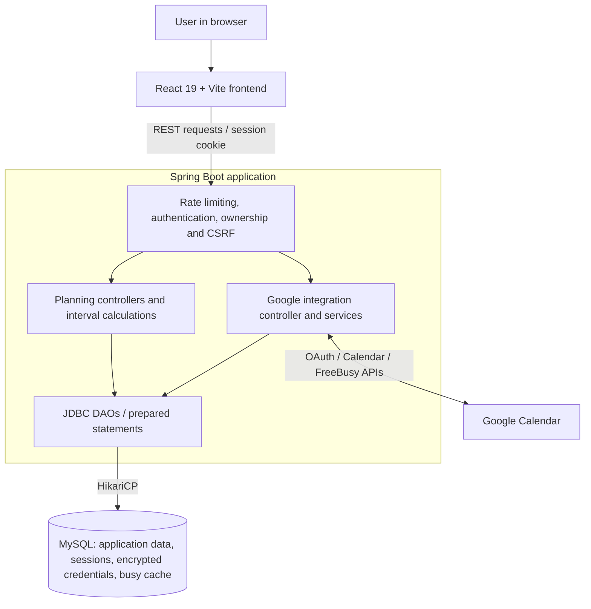

# Outing Planner

### Less back-and-forth. More getting together.

A full-stack application for finding shared free time, choosing an activity, and coordinating a group outing.

**React 19 · Java 17 · Spring Boot 4 · MySQL · Google Calendar API**

**Active development · Pre-MVP · Public portfolio showcase**

[Preview](#application-preview) · [Features](#implemented-features) · [Engineering](#engineering-at-a-glance) · [Architecture](#system-architecture) · [Deep Dives](#engineering-deep-dives) · [Testing](#testing-infrastructure) · [Roadmap](#roadmap)

## Overview

Making plans with friends can mean comparing several calendars, agreeing on an activity, and chasing responses in multiple conversations. Outing Planner brings those steps into one workflow:

**Compare availability → Explore activities → Propose an outing → Gather responses → Confirm the plan**

The goal is to reduce coordination friction. **This is an actively developed, pre-MVP project**: confirming an outing inside Outing Planner does *not* make a third-party reservation, buy tickets, or write an event to Google Calendar.

## Application preview

### Interactive calendar

The calendar combines personal events, scheduled outings, and day-level group-availability indicators.

### Explore, coordinate and connect

| Browse activities | Plan with friends |
| :---: | :---: |
|  |  |
| Search and filter the current development catalog. Some listings are demonstration data. | Choose an activity and time, and send a proposal to invited friends. |

| Google Calendar integration | Availability preferences |
| :---: | :---: |
|  |  |
| Connect Google Calendar, select calendars for FreeBusy, refresh availability, and optionally show your own events. | Define recurring weekly unavailable periods. The separate Planning Preferences panel is marked coming soon. |

Screenshots are from the development application and were reviewed and approved by the project owner for public display. See [screenshot review](SCREENSHOT_REVIEW.md).

## Engineering at a glance

| Challenge | Implemented approach | Explore |
| --- | --- | --- |
| **Find common free time** | Combine scheduling constraints and busy intervals, then calculate mutually free windows for participants. | [Availability walkthrough](docs/GROUP_AVAILABILITY.md) |
| **Integrate calendars without exposing details** | Use Google OAuth and cached FreeBusy information; keep owner-only event detail separate from shared availability. | [Google Calendar case study](docs/GOOGLE_CALENDAR.md) |
| **Protect user data across endpoints** | Server-side sessions, route ownership checks, CSRF validation, encrypted provider credentials and parameterized SQL. | [Security case study](docs/SECURITY.md) |

The app also supports a proposal lifecycle: invited participants respond, and the creator confirms once the required acceptance conditions are met.

## Implemented features

Capabilities checked against the development main branch on **October 20, 2026**.

| Area | Available in the development application |
| --- | --- |
| Accounts | Register, sign in/out, update profile, restore a session after refresh |
| Calendar | Personal events, scheduled outings, month navigation and availability overlays |
| Constraints | Recurring weekly unavailability, conflict checks, past-date and activity-hours validation |
| Friends | Find users by username or email; send, accept, decline and remove connections |
| Group availability | Compare one or several friends' available times across dates |
| Proposals | Create, respond to, cancel and confirm group outing proposals |
| Activity catalog | Browse/filter currently stored occasions by city, price, pet-friendliness and physical activity |
| Google Calendar | Connect/disconnect, select availability calendars, explicitly refresh FreeBusy, optionally display your own read-only events |

**Privacy boundary:** A friend's Google Calendar contributes busy time to the *availability calculation*, not event titles, descriptions, or individual busy-event cards to the group view. Showing the connected owner's events is a separate optional permission.

## System architecture

The following diagram describes the **implemented application**, not planned infrastructure.

**Key architectural boundaries:**

- **React frontend:** Presents the calendar, invitations, preferences and activity catalog; calls the backend through REST APIs.
- **Java backend:** Controllers handle planning workflows and availability logic; raw JDBC DAOs provide the persistence layer rather than an ORM.
- **MySQL:** Stores application entities, server-side sessions, encrypted Google credential material and cached external busy periods.
- **Google integration:** Explicit refresh populates FreeBusy cache for availability calculations. Reading the owner's event details is optional and does not store that event content in MySQL.
- **Privacy/security:** Authorization is enforced server-side. Friends' Google event contents are not exposed through shared availability responses.

This is a simplified component view, not a claim that the app uses microservices, real-time push updates or an automated Google write-sync service.

## Technology stack

| Layer | Technologies |
| --- | --- |
| Frontend | React 19, JavaScript, Vite 8, CSS, pnpm |
| Backend | Java 17, Spring Boot 4, Maven, REST controllers |
| Data | MySQL 8, raw JDBC, prepared statements, HikariCP, SQL migrations |
| Identity and security | Spring Session JDBC, BCrypt, CSRF and request authorization |
| Integration | Google OAuth 2.0, Calendar List, FreeBusy and owner-only read access |
| Testing and tooling | JUnit 5, Spring MockMvc, Vitest, React Testing Library, ESLint, GitHub Actions |

## Engineering highlights

- **Availability as interval processing.** Combine personal events, scheduled outings, recurring constraints, and cached external busy time; subtract busy intervals and intersect participants' free windows to identify shared time.
- **Privacy enforced across data paths.** Separate owner-only Google event display from shared availability. Disabling owner display stops retrieval in the backend, rather than merely hiding cards in the browser.
- **Time-zone and boundary handling.** Persist external busy intervals in UTC, project them into user-local dates, and handle midnight crossings and all-day versus timed events. Regression checks include raw stored UTC values across multiple JVM time zones.
- **A controlled proposal lifecycle.** Only the creator can confirm a proposal, confirmation requires accepted invitations, and expired proposals cannot be confirmed. Leaving a confirmed group outing affects the individual participant.
- **Security beyond the login screen.** Server-side sessions, session rotation on authentication, route ownership checks, CSRF validation, prepared statements, per-IP rate limiting, and encrypted provider tokens.
- **Integration discipline.** Frontend/backend contracts, explicit schema changes, focused regression tests, pull-request review, and separate CI checks support changes across the stack.

## Engineering Deep Dives

These public-facing case studies explain specific problems, design choices, trade-offs and known limitations without copying the private codebase:

- **[Finding Time Together — Group Availability](docs/GROUP_AVAILABILITY.md):** Annotated scheduling examples, interval processing and uncertain Google Calendar coverage.
- **[Google Calendar Integration](docs/GOOGLE_CALENDAR.md):** OAuth lifecycle, credential handling, caching and data separation.
- **[Backend Security](docs/SECURITY.md):** Session management, ownership checks, CSRF and defensive data access.

## Testing infrastructure

The private development repository uses four separate GitHub Actions checks:

| Check | Purpose |
| --- | --- |
| Backend tests | JUnit / MockMvc tests with isolated MySQL in CI |
| Frontend tests | Vitest and React Testing Library |
| Frontend build | Vite production build |
| Frontend lint | ESLint checks |

**Historical verified baseline (September 2026):** 628 backend tests executed (zero failures/errors; one intentional skip) and 686 frontend tests passed. The four CI checks were demonstrated passing at that baseline. These figures are *not* a current-head run or a test-coverage percentage. This public showcase repository itself does not build the application.

A separate, unmerged negative-control branch deliberately changed two assertions: both test gates failed while build and lint remained green. Backend CI initializes a base schema and replays SQL migrations in disposable MySQL; frontend jobs use the frozen dependency lockfile. Failing backend runs retain test reports for diagnosis.

## Development status

**Working now:** Accounts, personal events, friendships, multi-person availability, outing proposals, an initial activity catalog, and inbound Google Calendar availability/owner-event display.

The current application uses an explicitly refreshed FreeBusy cache, polling-based UI updates, a seeded activity catalog, and in-memory per-IP rate limiting for a single application instance. Calendar selection currently serves both availability and owner-event display; separate controls remain planned. This showcase provides no public live demo, and the application is not presented as production-ready.

## Roadmap

Planned work:

| Area | Next work |
| --- | --- |
| Reliability | Improve FreeBusy error recovery and scheduling/filter edge cases |
| Discovery | Expand the catalog of places and activities |
| Real-world coordination | Design external reservation/booking handoffs or integrations |
| Calendar export | Add outgoing confirmed-event synchronization to Google Calendar |
| Additional integrations | Explore support for Apple Calendar |
| Product polish | Improve updates, responsiveness, and the eventual demo experience |

The roadmap describes intentions, not completed functionality or release commitments.

## Project ownership

Outing Planner is an independently initiated software engineering project involving product planning, requirements, architecture coordination, backend/frontend integration, testing and iterative development. AI-assisted implementation and review tools are part of the workflow; engineering decisions and acceptance remain human-directed.

This public repository is a **portfolio showcase**. The development repository and its application source are private; there is no public source checkout or live demo here.

---

Portfolio snapshot prepared October 2026 · Implemented/planned boundaries are intentionally explicit.

