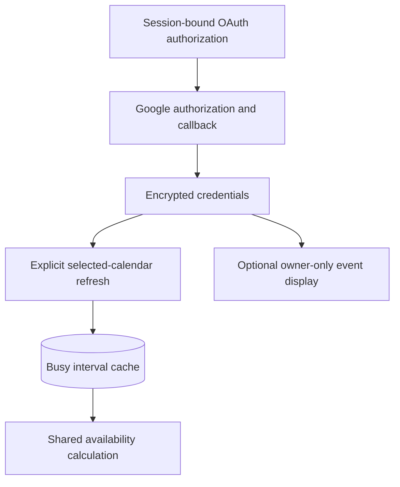

# Engineering Case Study: Connecting Google Calendar Without Exposing Private Events

[← Back to Outing Planner](../README.md)

## The problem

Asking users to recreate all their calendar commitments would make scheduling inconvenient. Integrating an existing calendar solves that problem, but it introduces OAuth permissions, credential management, stale data, time-zone interpretation, and privacy concerns for shared planning.

## What is implemented

Outing Planner supports an OAuth-based Google Calendar connection. Connected users can select calendars for availability, explicitly refresh FreeBusy information, and optionally enable **owner-only** event display in their own calendar view.

The initial connection is deliberately **read-only**. Refreshing availability is a separate user action after authorization and calendar selection. Displaying event details requires a separate, optional permission. The shared-availability calculation consumes busy intervals, not another user's detailed event content.

## Key engineering decisions

### Separate authorization for separate purposes

The base availability integration does not require the optional event-detail permission. If users decline that optional grant, their existing availability connection can remain usable. Permission to read event details and the preference to show those details are also separate gates.

### Session-bound OAuth flow

A login session stores temporary OAuth flow data, including state and PKCE verification material. The callback validates the flow context. This matters because redirects from Google cannot attach the application's normal CSRF header.

### Encrypted credentials and predictable disconnect

The application stores Google credential material encrypted at rest. Disconnect removes locally held credential material regardless of whether a remote revocation attempt succeeds. The account-identity record can remain to support reconnecting without treating it as an active credential.

### Cached external availability

A separate refresh operation retrieves FreeBusy information for the selected calendars. Availability computations then use cached intervals rather than live network calls. Busy periods are persisted in UTC and interpreted for local scheduling dates.

### Do not leak another participant's events

Owner event display and shared availability use different data paths. The owner can see their own permitted event cards; another person's private Google event details do not appear in the shared results. Disabling owner display stops event retrieval at the backend, not merely rendering.

## Limitations

This integration **does not** write new events to Google Calendar. Outgoing event synchronization, sync-job operations, and Apple Calendar integration are planned or deferred. The current calendar selection also serves both availability calculations and owner-event display; separate per-calendar controls are a proposed enhancement. FreeBusy refresh error recovery needs improvement. A failed refresh does not overwrite a valid current snapshot, but changing calendar selection invalidates the previous snapshot; a subsequent refresh failure can therefore leave external coverage unknown.

## Why this case study matters

The challenge wasn't simply sending HTTP requests to an API: it was defining what information could be obtained, retained, shared, and shown at each stage of the user's workflow.

*Verified against the development main branch on October 20, 2026. This public explanation summarizes behavior; it does not reproduce private source code or internal documentation.*
