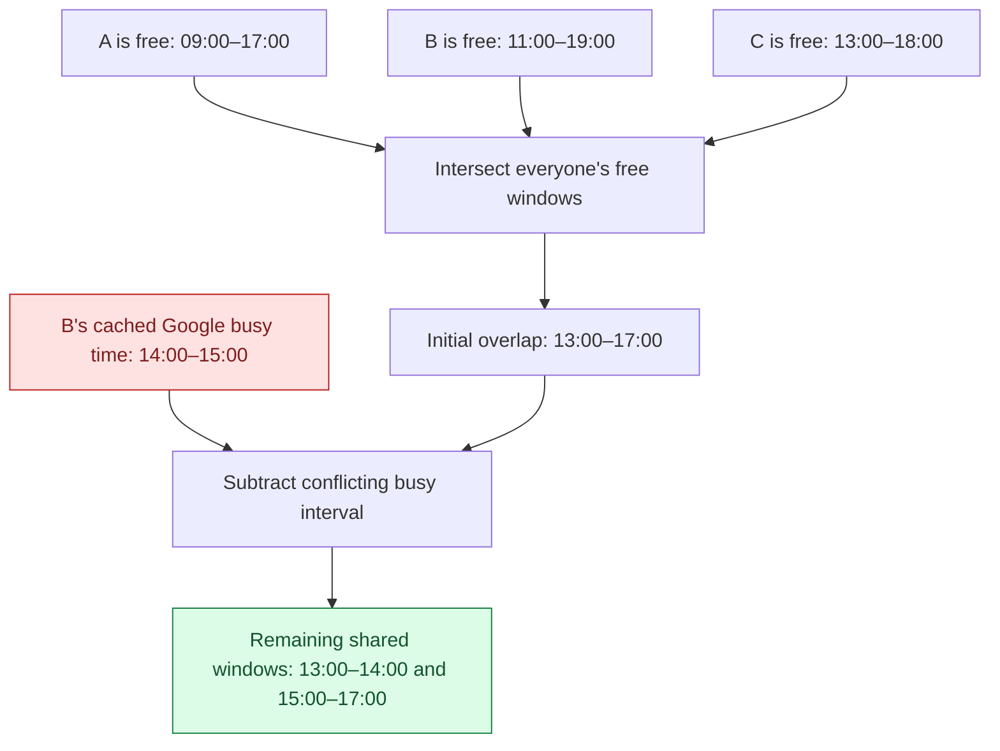
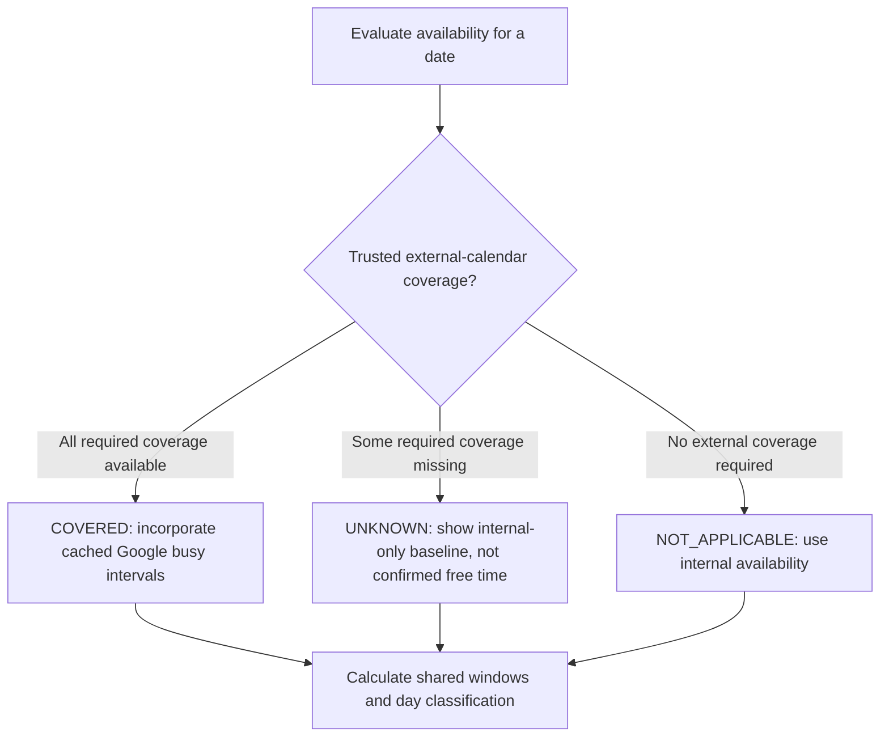

# Engineering Case Study: Finding Time Together

[← Back to Outing Planner](../README.md)

## The problem

A useful group planner needs more than a list of calendar events. Each participant has recurring unavailable times, scheduled events, and potentially external calendar commitments. The system must determine *mutually free windows* without treating missing external calendar information as free time.

## Visual walkthrough: finding the overlap

> **Illustrative example only.** The people and times below are fictional, not actual user information or a screenshot of the application. The simplified timeline illustrates interval intersection; the production system also accounts for busy-time subtraction and its fixed planning window.

Three friends are considering an outing on the same day:

| Participant | Free time before the sample Google conflict |
| --- | --- |
| Person A | 09:00–17:00 |
| Person B | 11:00–19:00 |
| Person C | 13:00–18:00 |

The overlap is **13:00–17:00**. Assume trusted external coverage for all contributing participants. Suppose Person B then has a Google Calendar commitment from **14:00–15:00**. That busy interval splits the shared window into **13:00–14:00** and **15:00–17:00**.

### Read the timeline

Each column represents a one-hour block. `🟩` means free throughout that hour; `⬜` means unavailable. The last row is the **mutual** availability after the example calendar conflict.

| Schedule | 09–10 | 10–11 | 11–12 | 12–13 | 13–14 | 14–15 | 15–16 | 16–17 | 17–18 | 18–19 |
| --- | :---: | :---: | :---: | :---: | :---: | :---: | :---: | :---: | :---: | :---: |
| Person A | 🟩 | 🟩 | 🟩 | 🟩 | 🟩 | 🟩 | 🟩 | 🟩 | ⬜ | ⬜ |
| Person B, including Google conflict | ⬜ | ⬜ | 🟩 | 🟩 | 🟩 | ⬜ | 🟩 | 🟩 | 🟩 | 🟩 |
| Person C | ⬜ | ⬜ | ⬜ | ⬜ | 🟩 | 🟩 | 🟩 | 🟩 | 🟩 | ⬜ |
| **Everyone** | ⬜ | ⬜ | ⬜ | ⬜ | **🟩** | ⬜ | **🟩** | **🟩** | ⬜ | ⬜ |

**Important distinction:** This example produces two free intervals; it does **not** mean the calendar day is classified `partial`. The current application's day-level `partial` threshold requires a *single continuous* free interval of at least **240 minutes**. Neither resulting interval meets that threshold. The day-level result could therefore be `unavailable` even though shorter scheduling windows are present.

## The implemented approach

Outing Planner models availability as time intervals. The main group calculation gathers and combines participants' busy intervals, merges overlaps, and computes the free-time complement within the supported planning window. Combining everyone's busy time before inversion is equivalent to intersecting their individual free windows; an additional availability endpoint also performs explicit free-window intersection.

The availability calculation accounts for existing personal events, scheduled outings, recurring unavailability, and cached Google Calendar FreeBusy intervals. Google busy intervals *remove* free time; they cannot create additional free time.

A shared day is classified as `full`, `partial`, or `unavailable` based on its free windows. The current backend uses a shared planning window of **08:00:00–23:59:59** and a hardcoded **240-minute** threshold in day classification. A day is full when a free window covers the entire planning window, partial when at least one continuous window reaches four hours, and otherwise unavailable—even if shorter free windows exist. The end-of-day sentinel is treated as midnight when measuring that threshold. These are current implementation constants, not user-configurable preferences.

## What if Google Calendar data is missing?

The application does **not** treat an unsuccessful or outdated external availability lookup as proof of free time. It carries a separate day-level `externalAvailability` value:

| Value | Meaning |
| --- | --- |
| `NOT_APPLICABLE` | No contributing external calendar coverage is needed |
| `COVERED` | The necessary cached external data covers the day |
| `UNKNOWN` | The available cached data cannot reliably establish external availability |

If any contributing participant lacks trusted external snapshot coverage, the group's external status is `UNKNOWN`. The calculation returns internal-only baseline windows rather than applying only some participants' known Google busy intervals. These windows must **not** be read as confirmed external-calendar availability. The shared API does not reveal which participant caused the unknown state.

## Why the design matters

**One interval-inversion path.** Both single-date and multi-day availability operations use a shared free-window inversion implementation. This avoids inconsistent handling of the planning boundary across endpoints.

**No live Google requests during comparisons.** An explicit refresh populates cached FreeBusy data. Availability requests read that cache, reducing provider coupling during the calculation.

**Privacy by design.** The shared availability API does not expose another participant's Google event titles, descriptions, or event-level busy cards. Friends' external calendar data influences calculated availability only.

**Clear handling of uncertainty.** The three-value external coverage state prevents the UI from silently presenting unavailable Google Calendar information as verified availability.

## Trade-offs and remaining work

The fixed planning window and classification threshold simplify consistent calculations but limit customization. External FreeBusy refresh is explicit, and a known error-recovery issue may leave the cache in an unknown state when a selected calendar cannot be queried. A documented sub-minute edge case remains unresolved, with a disabled regression test recording the desired behavior. These are tracked limitations, not solved features.

## Engineering takeaway

This subsystem illustrates how an apparently simple UI question—“When can everyone meet?”—becomes a problem in interval processing, boundary consistency, external-data uncertainty, and privacy-preserving API design.

*Grounded in the documented development main-branch behavior reviewed October 20, 2026. All timeline participants and times are illustrative. This public case study is a conceptual explanation, not a source-code mirror.*
